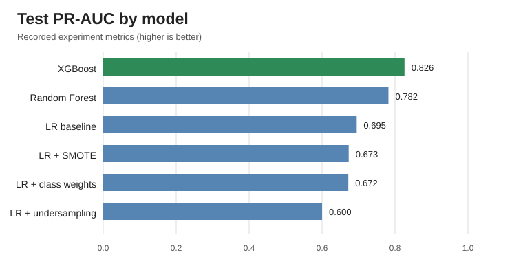
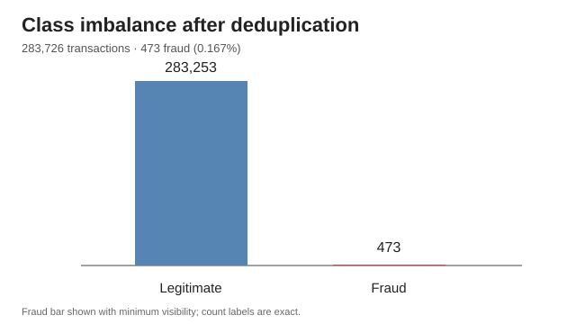
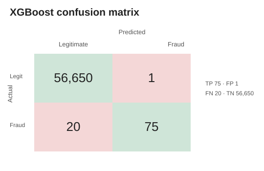

# 💳 Credit Card Fraud Detection

A Machine Learning project focused on detecting fraudulent credit card transactions using multiple classification algorithms and imbalanced-data handling techniques.

The project evaluates different machine learning models and compares their performance using precision, recall, F1-score, ROC-AUC, and PR-AUC.

## 📌 Project Overview

Credit card fraud detection is a highly imbalanced classification problem. Fraudulent transactions represent only a small fraction of all transactions, making conventional accuracy an unreliable evaluation metric.

This project explores different approaches to improve fraud detection while minimizing false positives.

### Objectives

* Analyze and understand the imbalance in transaction data.
* Build a Logistic Regression baseline model.
* Experiment with SMOTE, class weighting, and random undersampling.
* Compare Random Forest and XGBoost classifiers.
* Evaluate models using appropriate metrics for imbalanced classification.
* Identify the best-performing model.

## 🛠️ Tech Stack

| Category             | Technologies                           |
| -------------------- | -------------------------------------- |
| Programming Language | Python                                 |
| Data Processing      | Pandas, NumPy                          |
| Machine Learning     | Scikit-learn                           |
| Imbalanced Learning  | Imbalanced-learn, SMOTE                |
| Gradient Boosting    | XGBoost                                |
| Visualization        | Matplotlib                             |
| Evaluation           | Precision, Recall, F1, ROC-AUC, PR-AUC |

## 📊 Dataset

**Dataset:** Credit Card Fraud Detection — ULB

* Total transactions after duplicate removal: 283,726
* Fraudulent transactions: 473
* Legitimate transactions: 283,253
* Fraud percentage: Approximately 0.167%

The dataset contains anonymized transaction features and is highly imbalanced.

Dataset source: [Kaggle — Credit Card Fraud Detection](https://www.kaggle.com/datasets/mlg-ulb/creditcardfraud)

The dataset is not included in this repository due to its size.

## 🧠 Machine Learning Models

The following models and techniques were evaluated:

1. Logistic Regression — Baseline
2. Logistic Regression + SMOTE
3. Logistic Regression + Class Weights
4. Logistic Regression + Random Undersampling
5. Random Forest
6. XGBoost

## 📈 Model Performance

| Model               | CV PR-AUC | Test PR-AUC | Test ROC-AUC | Precision | Recall |   F1-Score |
| ------------------- | --------: | ----------: | -----------: | --------: | -----: | ---------: |
| XGBoost             |     0.853 |  **0.8263** |       0.9791 |    0.9868 | 0.7895 | **0.8772** |
| Random Forest       |     0.800 |      0.7816 |       0.9648 |    0.8659 | 0.7474 |     0.8023 |
| Logistic Regression |     0.753 |      0.6951 |       0.9575 |    0.8353 | 0.7474 |     0.7889 |
| LR + SMOTE          |     0.752 |      0.6729 |       0.9600 |    0.8571 | 0.7579 |     0.8045 |
| LR + Class Weights  |     0.754 |      0.6719 |       0.9657 |    0.8571 | 0.7579 |     0.8045 |
| LR + Undersampling  |     0.602 |      0.6004 |       0.9554 |    0.6577 | 0.7684 |     0.7087 |

### 🏆 Best Model: XGBoost

XGBoost achieved the best overall performance in the recorded experiment.

* **PR-AUC:** 0.8263
* **ROC-AUC:** 0.9791
* **Precision:** 98.68%
* **Recall:** 78.95%
* **F1-Score:** 87.72%

The results indicate that XGBoost provided the strongest balance between detecting fraudulent transactions and minimizing false positives among the evaluated models.

## 📉 Visualizations

### Test PR-AUC Comparison



### Class Imbalance



### XGBoost Confusion Matrix



## ⚙️ Installation and Usage

### 1. Clone the Repository

```bash
git clone https://github.com/Mars0981/credit-card-fraud-detection.git
cd credit-card-fraud-detection
```

### 2. Create a Virtual Environment

```bash
python -m venv .venv
```

### 3. Activate the Environment

Windows:

```powershell
.venv\Scripts\activate
```

Linux/macOS:

```bash
source .venv/bin/activate
```

### 4. Install Dependencies

```bash
pip install -r requirements.txt
```

### 5. Download the Dataset

Download the dataset from Kaggle and place the CSV file at:

```text
data/creditcard.csv
```

### 6. Run the Project

```bash
python src/fraud_experiments.py
```

Generated results and figures are saved in the `results/` directory.

## 📂 Project Structure

```text
credit-card-fraud-detection/
│
├── data/
│   └── creditcard.csv              # Dataset (not included)
│
├── results/
│   ├── figures/
│   │   ├── test_pr_auc.svg
│   │   ├── class_imbalance.svg
│   │   └── xgboost_confusion_matrix.svg
│   │
│   ├── actual_metrics.csv
│   ├── results.csv
│   ├── results.md
│   └── run_info.json
│
├── src/
│   └── fraud_experiments.py
│
├── requirements.txt
├── .gitignore
└── README.md
```

## ⚠️ Limitations

* The dataset contains historical transactions and may not represent current fraud patterns.
* Anonymized PCA features limit interpretability.
* Model performance may vary across different datasets.
* Real-world deployment would require continuous monitoring, temporal validation, and cost-sensitive threshold selection.

## 🚀 Future Improvements

* Implement real-time fraud detection using FastAPI.
* Develop a transaction fraud prediction dashboard.
* Add explainability using SHAP.
* Experiment with deep learning models.
* Implement real-time model monitoring.

## 👨‍💻 Author

**GitHub:** [Mars0981](https://github.com/Mars0981)

---

⭐ If you find this project interesting, consider giving the repository a star!
